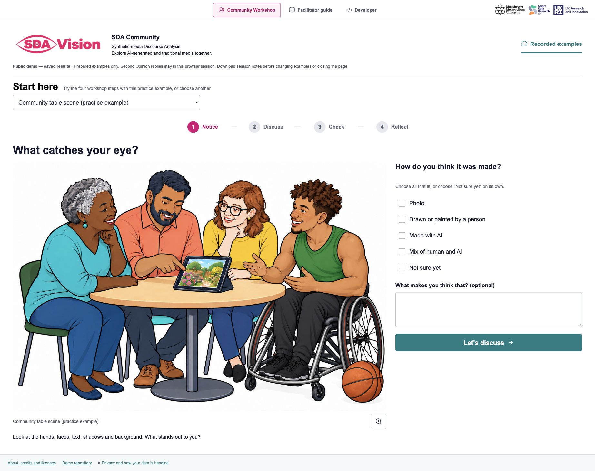

<p></p>

# Research software and release preparation

[](https://zenodo.org/doi/10.5281/zenodo.23008102) · [](https://zenodo.org/doi/10.5281/zenodo.23008188)

SDA stands for **Synthetic-media Discourse Analysis**. SDA Vision supports research and group discussion about **AI-generated and traditional media**.

[**Play Hearsay Harbour**](https://sdavision.io/#game), the SDA Vision island game. **Game → Demo** offers individual play, Workshop mode and an Arcade / TV remote launch link. Optional keeper or group names appear on certificates, recaps and exported findings; **Game → Dev mode** introduces the local tools for adapting picture packs. [Game source and credits](https://github.com/Synthetic-Realities/hearsay-harbour#hearsay-harbour) · [Game downloads and Concept DOI](https://doi.org/10.5281/zenodo.23243671).

[](https://sdavision.io/)

The demo opens in **Community Workshop**. [Explore the live demo](https://sdavision.io/).

The opening illustration supports all four workshop activities and has saved
Claude, OpenAI and Gemini findings. The menu offers ten further examples.
[Workshop and Facilitator guide](docs/Workshop_Activities_2026-09-25.md).

An academic research project of **Synthetic Realities**, led by **Dr Sam Martin**, Smart Data Research UK (UKRI) Fellow (Grant number UKRI4010), Manchester Metropolitan University (MMU). [ORCID: 0000-0002-4466-8374](https://orcid.org/0000-0002-4466-8374).

Try the [saved-results demo](https://sdavision.io/).
It contains ten menu examples and an opening practice illustration. All eleven have recorded Claude, OpenAI and Gemini
assessments. Visitors select
bundled examples, compare results and download reports. The website uses
prepared media and saved assessments; visitor uploads and live analysis are
outside this demo profile.

The [public software repository](https://github.com/Synthetic-Realities/sda-vision-source) begins with the approved 0.1.0 source archive. This development repository remains private. [Software 0.1.1](https://zenodo.org/records/23039037) and [facilitator guide 1.4](https://zenodo.org/records/23008189) are published on Zenodo. The badges above resolve to the latest published version in each series.

[Software 0.1.3 and guide 1.7](release/RELEASE_0.1.3.md) include the simpler paired external-check workflow. The participant sheet is included with the guide. Codex and Claude Code provided AI-assisted development support under Dr Sam Martin's direction and review.

Current delivery profiles and installation evidence are recorded in
[Demo acceptance, 26 September](docs/DEMO_ACCEPTANCE_2026-09-26.md). The public
interactive demo uses prepared examples and saved results; the presenter-only
Conference profile performs live analyses of its listed originals. The research
app described below retains its local file workflow. Delivery and processing settings stay fixed when switching layouts.

SDA Vision supports qualitative research into AI-generated and traditional media. In the local
research app, select an image, document, video, audio file or transcript to
compare **model assessments, credential findings and supporting observations
side by side**. Each result records its coverage, evidence and the reasoning
behind the combined assessment.

Built as the technical analysis layer of Synthetic-media Discourse Analysis (SDA),
the research app uses your own provider accounts and API keys (BYOK).

> This work was supported by Smart Data Research UK, a UKRI investment; Grant number UKRI4010.

Google Lens is available for image files. PDFs, slides, podcasts and videos retain their original-file downloads, with image-search controls reserved for images. [Image-search scope](docs/Image_Search_Scope_2026-09-29.md).

Reflect keeps its findings and Evidence box inside **Revisit the recorded findings**, collapsed until opened. Session notes and New session remain visible. [Software 0.1.1 release details](release/RELEASE_0.1.1.md).

## Developer view and project resources

The Developer view compares the recorded model assessments, credential findings and supporting observations. Its header links to the public GitHub project and illustrated facilitator guide, with an expandable citation for the demo. Green status dots indicate available recorded results; each report supplies the check details. The Batch queue is collapsed until selected, with file and selection counts visible. Each analysis includes a Harvard-style software citation for Dr Sam Martin, MMU and the Smart Data Research UK funding acknowledgement, grant UKRI4010. [Batch and citation details](docs/Batch_And_Citation_2026-09-28.md).

The [MIT software release and installation guide](https://github.com/Synthetic-Realities/sda-vision-source#start-here) are publicly available. [Developer view and website discovery](docs/Developer_Demo_And_Discovery_2026-09-27.md) records the current publication status and search metadata.

## Illustrated facilitator guide

For **community facilitators, trainers, educators and researchers** leading workshops, conference sessions or online discussions about AI-generated and traditional media. The eight-page guide combines screenshots, colourful group questions and practical notes for **Notice → Discuss → Check → Reflect**.

Before the session, read through the pack and choose an example you have permission to share. With the group, invite first impressions, compare explanations and then explore the recorded findings. Close by choosing practical next steps and downloading any session notes you want to keep. Adapt the pace and questions to the group.

[Explore the guide and how to use it](https://sdavision.io/#facilitator) · [Repository guide](docs/Facilitator_Guide.md).

| Notice | Discuss |
| --- | --- |
| [](docs/images/workshop-activity-1-notice-v1.7.png) | [](docs/images/workshop-activity-2-discuss-v1.7.png) |

| Check | Reflect |
| --- | --- |
| [](docs/images/workshop-activity-3-check-v1.7.png) | [](docs/images/workshop-activity-4-reflect-v1.7.png) |

Start with the **Community table scene (practice example)**. Invite first impressions before opening its creation note at Check. Choose other prepared examples agreed for your session. The guide explains all four activities, expandable model evidence and the separate scope of transcript and sound findings.

[Download the full facilitator pack (PDF, version 1.7)](docs/guides/SDA_Vision_Facilitator_Guide_v1.7.pdf) · [Participant instructions](docs/Participant_External_Checks.md) · [One-page participant sheet](docs/guides/SDA_Vision_Participant_Checks_v1.7.pdf).

[Historical local preparation record, 15 October 2026](release/review-2026-10-15/README.md). The current release is described in [0.1.3 release notes](release/RELEASE_0.1.3.md).
bring together the current app, recorded demo, facilitator guide and participant
sheet. Previous release records retain their original dates and versions.

## How the verdict works

SDA Vision combines model assessments, Content Credentials and supporting
file checks through a defined set of decision rules. Each result records
the findings, coverage and reasoning behind the verdict.

- **Content Credentials provide evidence of declared origin.** A C2PA
  declaration of AI-generated or AI-composited content takes precedence
  when validation is complete and integrity and signer trust meet the
  configured policy. Missing credentials leave origin unresolved by
  this check.

- **Vision assessments use corroboration between models.** At least two
  matching, eligible model votes are required for a model-based verdict.
  Each vote must meet the verdict-and-rating rules. Where the available
  assessments do not meet these rules, the result is Inconclusive.
  Statistical independence between models is not assumed.

- **Uncertainty remains visible.** An Inconclusive model reply contributes
  no directional vote, whatever its rating. Ratings remain available for
  comparison and are not calibrated probabilities. See the
  [26 September method record](docs/Method_Change_Record_2026-09-26.md).

- **Local forensics adds supporting observations.** File-level findings
  can corroborate model assessments and help guide further review.
  They cannot determine the verdict on their own.

- **Video and document results retain their individual findings.**
  Sampled frames or pages appear alongside the combined assessment and
  an indicative summary rating. A mixture of likely authentic and
  synthetic findings produces an Inconclusive combined verdict,
  directing attention to the individual results.

- **Watermark coverage depends on the available service.** The current
  release has no configured automatic watermark detector. Manual
  external checks and pasted Second Opinion replies provide additional
  context outside the combined score.

Reports organise the findings under “Evidence supporting this verdict”
and “Additional findings”. “Context for this result” explains individual
checks, while “How this assessment was reached” records the decision
steps. Timestamped summaries support reporting and citation.

## Signals in the table

| Provider | Type | Signal |
|---|---|---|
| Claude / OpenAI / Gemini Vision | interpretive | structured synthetic-likelihood + tells |
| External watermark check | manually recorded evidence | SynthID Detector response, exact checked file and scope; separate from model scores |
| Watermark adapter | watermark | legacy optional endpoint, currently unconfigured; separate from the public SynthID Detector website |
| C2PA Content Credentials | provenance | validated, trusted AI declarations can override; camera declarations describe capture; the scene and accompanying claims need their own evidence |
| Local forensic cues | forensic | EXIF / ELA / noise / FFT (supporting only) |

## Run it

```bash
./run.sh
```

The command launches the installed app using its existing backend and
frontend build. By default, it runs on localhost, selects an available
port starting at 8100, and prints the address to open. You can also
double-click `boot-vision.command` to launch it in the same way.
Installation and frontend rebuilding are handled separately through
`setup.sh`.

On a new machine, run `./setup.sh` once (native Python 3.12 is the tested runtime,
Node 20.19+ on 20.x or Node 22.12+, and internet access; Apple Silicon macOS is the
tested platform).
It creates `.venv`, installs hash-locked Python dependencies, uses `npm ci`, builds the frontend
and creates `.env` if missing. Add approved API keys to `.env`, then use
`./run.sh`. Every provider is optional. After editing frontend source, explicitly
run `./setup.sh --build-only` before launch. Complete setup before the presentation so the installed build is ready to launch.

**PowerPoint slide previews:** install LibreOffice separately on the backend computer to preview uploaded `.pptx` decks. The public demo uses prepared slides. See [PowerPoint preview setup](docs/PowerPoint_Preview_Setup.md) for installation, controls and preview scope.

For the versioned software/archive preparation work, see
[`release/README.md`](release/README.md) for the current preparation pack and
[`release/RELEASE_NOTES.md`](release/RELEASE_NOTES.md) for changes and remaining checks.

For updated provider IDs and exact `.env` instructions, see
[`docs/Provider_Upgrade_2026-09-24.md`](docs/Provider_Upgrade_2026-09-24.md).
For new OpenAI/Google examples, see
[`docs/Example_Pack_Replacement.md`](docs/Example_Pack_Replacement.md).

C2PA runs offline and reports integrity and declared provenance. Provenance
overrides additionally require a reviewed local trust snapshot; see
[the trust policy](docs/C2PA_Trust_Policy.md). Watermark checks follow the
manual workflow described above. The C2PA 2.4-targeted candidate uses Python
SDK 0.37.12 / native 0.91.0; validator certification has not been established. See the
[upgrade and limitations](docs/C2PA_2_4_Upgrade_2026-09-24.md) and
[ByteDance, Adobe, Runway, Midjourney and LinkedIn scope](docs/Platform_Provenance_Scope_2026-09-24.md).

## Multimodal input

| Input | Handling |
|---|---|
| Image | analysed directly |
| PDF | `PDF_MODE=auto` extracts embedded figures, falling back to page rendering; C2PA on the original |
| PPTX | embedded slide images; text-only analysis when no visual frames are extracted, explicitly noted in the report |
| Video | frames sampled across the timeline (ffmpeg); per-frame verdicts |
| Transcript (txt/srt/vtt/md) | text content-analysis pass |
| Audio (m4a/mp3/wav) | transcoded + transcribed (Gemini-native, Whisper fallback), then analysed as text |

Video uploads also receive local soundtrack inspection. Optional Google audio-content
assessment and Suno credentials checks each require separate explicit consent and
are recorded alongside the visual verdict, outside its score. See [Soundtrack workflow](docs/Audio_Workflow_2026-09-24.md)
for coverage, external data flows and limitations. AI-origin detection from the sound itself is outside this workflow.

## Vaccine and health research lens (optional)

This lens adds suggested vaccine-and-health framing codes for human
review during the fellowship case study and community workshops.
It supports qualitative analysis of how health issues are presented
and discussed. Researchers interpret the codes alongside the source,
context and wider evidence; judgements about factual accuracy belong
to that broader review.

The app starts in its general-purpose configuration. Set
`ENABLE_VACCINE_LENS=true` to make the research lens available.

## Local research features

Set `DEV_MODE=true` in `.env` on your own access-controlled machine to enable:

- **Local corpus browser** for picking research files.
- **Saved runs** - every analysis is written to `dev_runs/` (with a perceptual
  hash per frame) so results accumulate for the next phase of analysis.
- **Batch upload** - select up to 5 files at once; each is analysed and saved.
- **Symbolic-diffusion graph** - `scripts/build_diffusion_graph.py` turns the
  accumulated `dev_runs/` (or a corpus subset) into a GEXF graph for Gephi, where
  perceptual-hash similarity groups visually related items for further investigation.
  Distribution history: not assessed. The public demo provides a prepared graph
  of its example set; local corpus analysis belongs to the research app.

## Stack

- Backend: FastAPI (Python). All detection logic is here and framework-agnostic.
- Frontend: React + TypeScript (Vite), in `frontend/`. Self-contained; designed
  with clean component boundaries so it can later be adapted as a plugin.

## Data protection and privacy

The local research app uses your own API accounts and keys
(bring-your-own-key, or BYOK). It reads keys from the process environment
or `.env` to authenticate requests to configured providers. The supplied
`.gitignore` excludes `.env` files and saved research runs.

Media preparation and local checks run on your machine. Enabled external
analyses send the relevant media, excerpts or text to the selected
providers, under their account terms and data-handling policies.
The app does not collect usage telemetry.

Processing uses memory and, for some media and export operations,
temporary local files. These files are removed after normal processing;
interrupted processing may leave files requiring cleanup.

**Recorded-demo external checks:** SynthID Detector and the OpenAI image checker
appear side by side, each with a visible results box. Return from the service
and paste its complete reply into **SynthID results** or **OpenAI results**.
The demo offers prepared examples only, with page or slide images for document
checks. Its OpenAI shortcut is enabled for image examples. Replies stay in the
browser session, separately from the recorded findings and model scores.
Download session notes before changing example or reloading. The dedicated
SynthID Detector replaces the former Gemini chat shortcut in this demo.

Google or OpenAI receives the file or image you choose on its service, including
retained metadata, under that service's account, current terms and any charges,
separately from SDA's API accounts. Opening a link sends no media.

The separate research app retains its detailed external-check form, including
file identity, date, reported scope and outcome. A manually pasted reply is not
an independently verified service response. See [workflow and scope](docs/External_Watermark_Checks.md)
and [participant instructions](docs/Participant_External_Checks.md).

### Planning your research use

- **Code and media permissions:** the MIT licence applies to the project's
  code. Media and datasets have their own permissions and terms.
  Data-protection obligations apply to your use of personal data.

- **Institutional and provider roles:** identify the controller and
  processor roles for your actual research workflow with your
  institution's Data Protection Officer (DPO). Review the data flows
  and security arrangements before moving to shared hosting.

- **Personal and sensitive information:** media and transcripts may
  identify people or reveal information about their health, political
  opinions or religious beliefs. Apply your institution's
  data-protection policy to this material, including publicly
  available sources.

- **Assessment and approvals:** work with your institution and DPO to
  establish the appropriate lawful basis, safeguards and scope of any
  Data Protection Impact Assessment (DPIA). Complete a DPIA where
  required and review it when the processing changes.

- **Saved research records:** with `DEV_MODE=true`, analyses are saved
  unencrypted in `dev_runs/`, including reports, thumbnails, filenames
  and extracted text where available. Use this mode on your own
  access-controlled machine. Keep these records local and delete them
  according to your project's retention schedule. The Public preview
  toggle leaves this storage setting unchanged.

See [`PRIVACY.md`](PRIVACY.md) for the detailed data flows, storage
behaviour and information supporting institutional review.


## Licence

The project's own code is currently MIT (see `LICENSE`). Dependencies and media
have their own terms. PDF preparation now uses BSD-licensed pypdf and the
permissively licensed pypdfium2/PDFium stack; see
[the PDF preparation change record](docs/PDF_Dependency_Change_2026-09-26.md).
The researcher confirmed MIT as the agreed code licence on 26 September 2026.
See `third_party/` for exact bundled notices and `examples/CREDITS.md` for media
terms. Binary distributions must also retain their installed dependencies' notices.

## Benchmark

```bash
source .venv/bin/activate
python evaluate_corpus.py --vision   # also call the paid vision APIs
```

[Current interface and release-pack review](docs/Release_Pack_Audit_2026-09-27.md) covers the integrated facilitator guide, media previews, batch checklist and refreshed screenshots.

## Affiliation and funding

<p> &nbsp;  &nbsp; </p>

Smart Data Research UK (UKRI) Fellowship, Grant number UKRI4010, hosted at Manchester Metropolitan University. Partner logos identify the affiliation and funding; their rights remain with their owners.

## Podcast source exploration

The final, source-informed workshop verdict is **Mix of human and AI**: human-authored research, selected by Dr Sam Martin and adapted into a podcast with Google NotebookLM. Following the cover citation, finding the publication and comparing a podcast statement with the paper helps the group reach a fuller Human–AI reflection. The recorded transcript ratings and separate audio-excerpt description remain available with their original scope; they inform the discussion alongside the additional source evidence.

[Follow the source](docs/Podcast_Source_Activity.md) adds podcast-specific prompts and a source reveal to the workshop. The [facilitator guide, version 1.7](docs/guides/SDA_Vision_Facilitator_Guide_v1.7.pdf), includes the activity. Session downloads carry the displayed cover or document preview, with the recorded analysis preserved separately.

[Software 0.1.2 and facilitator guide 1.5 distribution notes](release/RELEASE_0.1.2.md).
