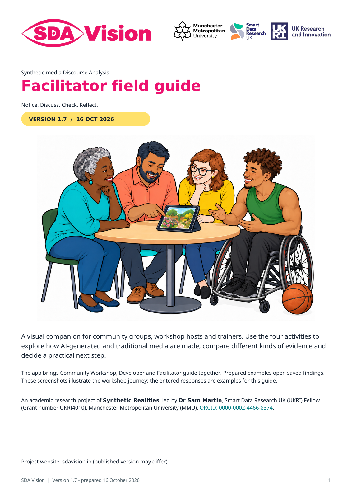
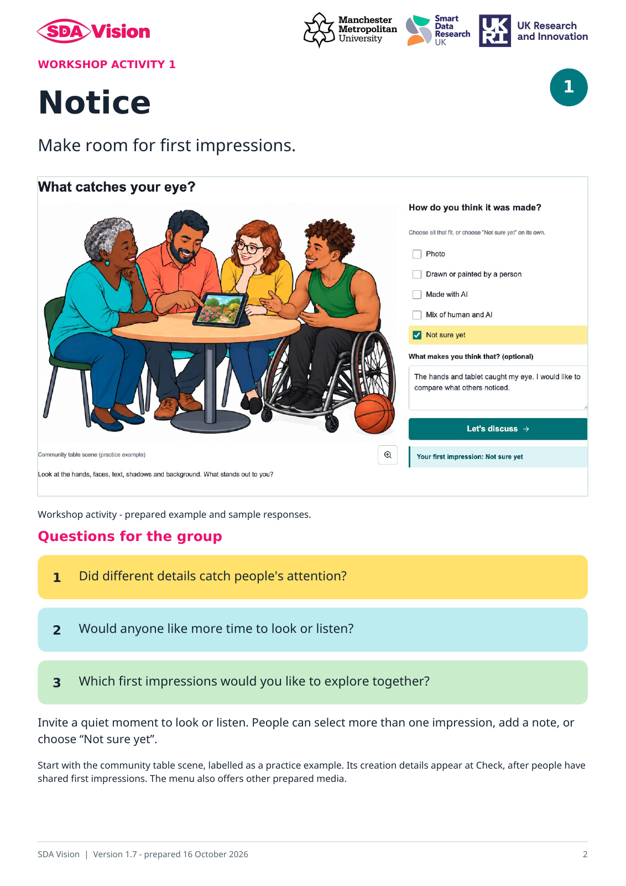
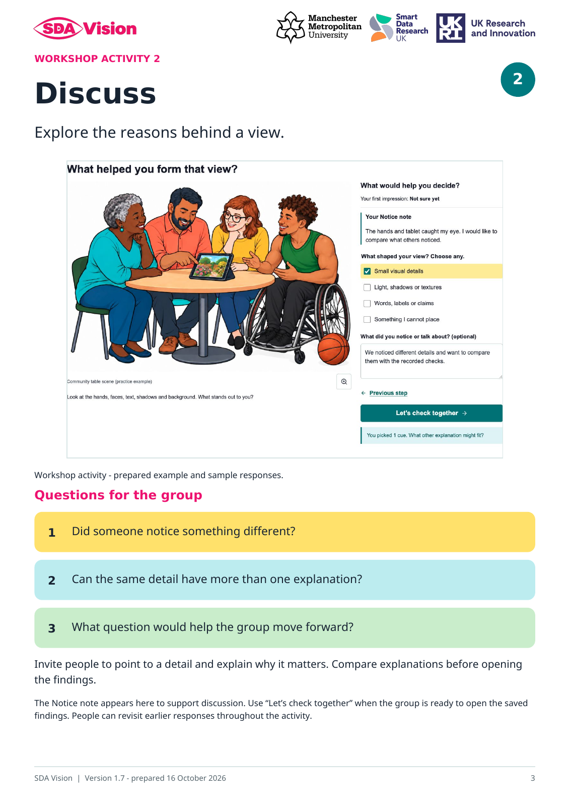
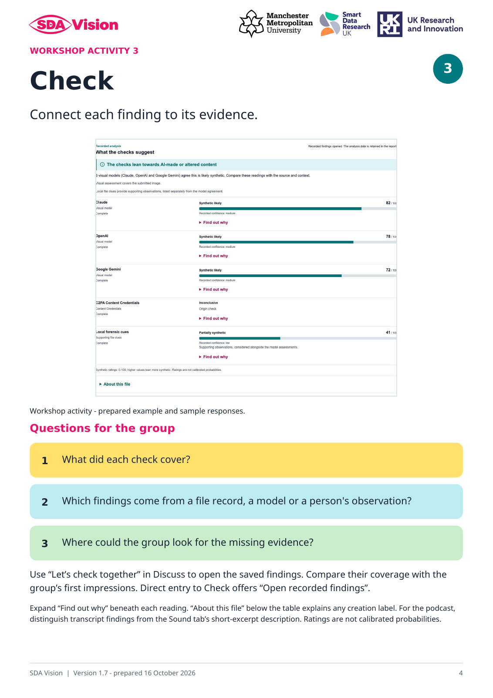
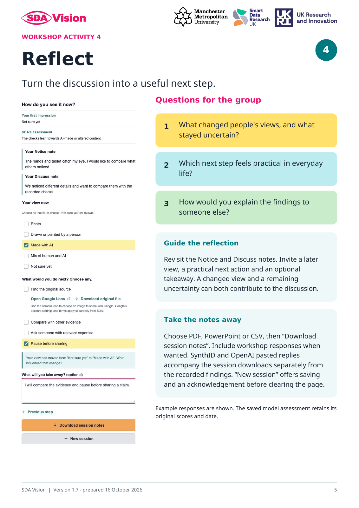
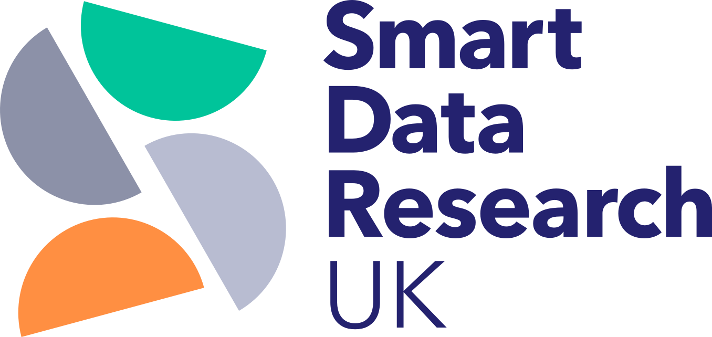
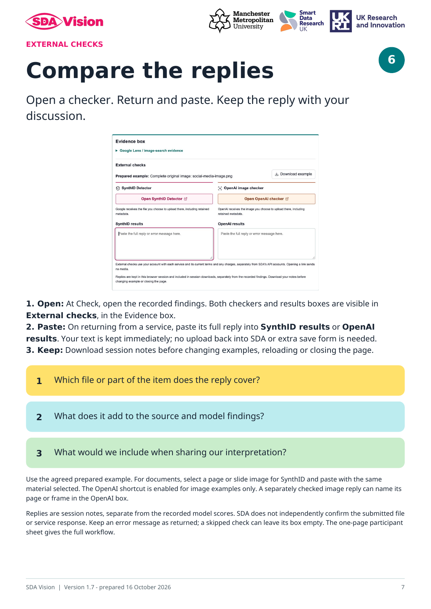

# SDA Vision: Facilitator field guide — version 1.7

SDA means **Synthetic-media Discourse Analysis**.

An academic research project of **Synthetic Realities**, led by **Dr Sam Martin**, Smart Data Research UK (UKRI) Fellow (Grant number UKRI4010), Manchester Metropolitan University (MMU). [ORCID: 0000-0002-4466-8374](https://orcid.org/0000-0002-4466-8374).

[Download the eight-page facilitator guide (PDF)](guides/SDA_Vision_Facilitator_Guide_v1.7.pdf).

For community facilitators, trainers, educators and researchers leading workshops, conference sessions and online discussions about AI-generated and traditional media. Use the guide alongside SDA Vision’s **Community Workshop**, adapting the questions to your group. The four activities invite first impressions, comparison of ideas, exploration of recorded findings and practical next steps.

Start with the clearly labelled practice illustration or another prepared example agreed for your session. This recorded demo accepts prepared media only. Participants can record a first impression before seeing the project’s creation note at Check. The model table offers expandable evidence, while **About this file** summarises any embedded creation labels. Podcasts separate the assessed transcript excerpt from observations about sound.

The guide includes the four activity pages below. Read the preparation notes before a session; at the end, invite reflection and download session notes before using **New session**. Responses and pasted checker replies remain separate from the recorded model findings. [Participant instructions](Participant_External_Checks.md) provide the short return-and-paste workflow and a printable one-page sheet.

## Workshop Activity 1 — Notice

## Workshop Activity 2 — Discuss

## Workshop Activity 3 — Check

## Workshop Activity 4 — Reflect

## Podcast: follow the source

The NotebookLM podcast draws on research published by Sam Martin and Samantha Vanderslott in *Vaccine*. Its cover contains the publication citation. The activity separates how the podcast was produced, what it draws on, and how faithfully it represents the source.

The final, source-informed workshop verdict is **Mix of human and AI**: human-authored research, selected by Dr Sam Martin and adapted into a podcast with Google NotebookLM. Following the cover citation, finding the publication and comparing a podcast statement with the paper helps the group reach a fuller Human–AI reflection. The recorded transcript ratings and separate audio-excerpt description remain available with their original scope; they inform the discussion alongside the additional source evidence.

| Step | Invitation |
| --- | --- |
| Notice | Listen to a short section. What shapes your first impression of how this podcast was made? |
| Discuss | Take a closer look at the cover image. Which names, dates or references could help you trace its source? |
| Check | Search for a distinctive phrase from the title or the authors’ names. Can you find the publication? Choose one statement from the podcast and compare it with the paper. |
| Reflect | What have you learned about the research and about the podcast’s production? How would you describe both when sharing it? |

[Search Google for the publication](https://www.google.com/search?q=%22Martin%22%20%22Vanderslott%22%20%22mask%22%20%22vaccine%22) · [Read the research paper](https://doi.org/10.1016/j.vaccine.2021.10.031). In the app both links open a new tab. The search sends the public author names and topic to Google; it sends no recording, transcript or participant responses.

After first impressions, participants can open **Explore the source behind this example** at Check or Reflect. Dr Sam Martin supplied the creation record: she made the podcast with Google NotebookLM using the research she co-authored with Samantha Vanderslott. A publication match establishes a source connection; comparing statements helps assess how the adaptation summarises, simplifies or extends the research.

The saved findings assess the first 12,000 characters (about 46%) of the transcript. Built-in audio checks: AI-origin detection from the sound itself is outside this workflow. External watermark records have their own file and coverage. The 78, 90 and 95/100 model ratings are not calibrated probabilities. The source activity and participant reflections remain separate from those findings.

The session PDF and PowerPoint include the displayed cover or document preview where available, with a caption distinguishing it from analysed frames. The source reveal enters the session summary only after it has been opened. Original reports and their thumbnails remain unchanged.

## Version and publication

Version 1.7, 16 October 2026, updates the guide and participant instructions for the visible SynthID Detector / OpenAI checker pair. It replaces the longer file-identity form in the demo instructions. Earlier guide editions remain available as historical records. The [guide Concept DOI](https://zenodo.org/doi/10.5281/zenodo.23008188) identifies the version family. The editable conference PowerPoint stays local and is excluded from release packs.

## Affiliation and funding

Codex and Claude Code provided AI-assisted development support under Dr Sam Martin's direction and review.

  

Smart Data Research UK (UKRI) Fellowship, Grant number UKRI4010, hosted at Manchester Metropolitan University. Logo rights remain with their owners. See [licence](../LICENSE) and [artwork credits](branding/README.md).

## External Checks: Compare The Replies

The eight-page guide includes both visible checkers. At **Check**, open the recorded findings and find **External checks** in the Evidence box. SynthID Detector and the OpenAI image checker sit side by side, each with a paste-results box; they stack on narrow screens.

Returning from a service takes one step: paste its complete reply into **SynthID results** or **OpenAI results**. There is no upload back into SDA, separate save button, date field or outcome form. Pasted replies stay in browser memory and accompany session downloads separately from the recorded model scores. SDA does not independently confirm the service response or the submitted file.

For an optional external check, download the agreed prepared example and open the chosen service. For a document, use its prepared page or slide image and paste with that material selected. The OpenAI shortcut remains enabled for image examples only. The dedicated SynthID Detector replaces the former Gemini chat shortcut in this demo; recorded Google Gemini model findings remain unchanged.

Before participants choose an external upload, explain that Google or OpenAI receives the selected file or image, including retained metadata, under that service's account settings, current terms and any charges, separately from SDA's API accounts. Opening the link sends no media. Offer a facilitator demonstration or previously recorded reply as an alternative. Check access and current service limits in advance.

Download session notes before changing examples, reloading or closing the page. Use **Take the findings with you** in Community, or **Download session with your notes** in Developer. Original recorded-report downloads retain the earlier findings.

Invite the group to ask: What material does the reply cover? What does it add to the source evidence? What would we include when sharing our interpretation?

[Participant quick guide](Participant_External_Checks.md) | [Printable participant sheet](guides/SDA_Vision_Participant_Checks_v1.7.pdf) | [Workflow and coverage](External_Watermark_Checks.md).

