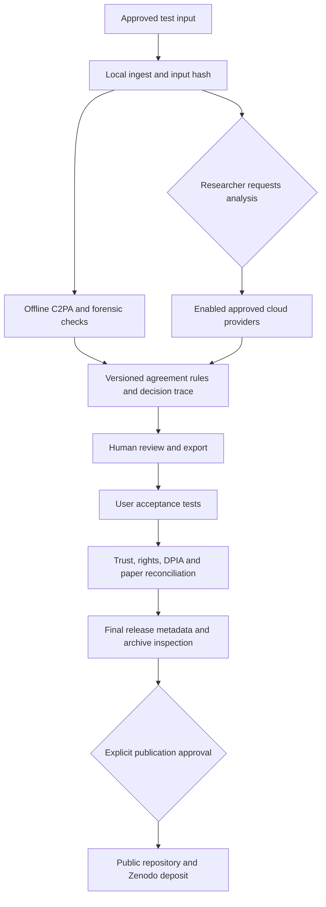

# Release Candidate: Ready For Your Testing

**Status: local test candidate, not approved for upload or publication.**
Method: `publication-repair-2026-09-19.2`. Model panel unchanged.
This record follows the earlier repair milestone, not a new ethics submission.

## Start Here

1. Open `http://localhost:8100/` for the repaired full app.
2. On another day, start it with `./run.sh` or `boot-vision.command`.
3. Leave ports 8110/8111 as the frozen historical showcases until you approve replacements.
4. Use approved, non-sensitive examples for your first live tests. Model calls cost money.
5. Stop after one test format and record what happened. You do not need to test everything in one sitting.

The current local `.env` still enables dev mode: real analyses are retained in
`dev_runs/`. Public preview does not turn that retention off. No keys, consent
settings, approved recipients or saved historical results were changed here.

## Completed Technical Checks

| Check | Result | Scope / limitation |
|---|---|---|
| Automated Python suite | 126 passing tests | Offline fixtures/mocks plus real local SDK checks; not a detection benchmark |
| Frontend | Clean `npm ci`, TypeScript and Vite build pass | Vite 7.3.6, React plugin 5.2.0; React remains 18 |
| Dependency audits | No known advisories in final npm and Python lockfiles | Point-in-time registry checks, not a security certification |
| Native Python installation | Hash-locked install and `pip check` pass | Apple Silicon macOS, CPython 3.12.14; other platforms untested |
| C2PA | SDK 0.37.10; actual configured offline reader tested | Reviewed trust snapshot not installed; provenance overrides disabled |
| Graph population | Counts survive JSON, GEXF, CSV ZIP and PNG | Corpus labels are not model analyses; similarity is not observed diffusion |
| Method guardrails | Single-model and frame-minority abstention tests pass | Rules are research heuristics, not calibrated probabilities |
| Browser checks | Desktop 1440x1000 and mobile 390x844 pass | Mocked provider responses; selection, note consent and stale-result guards tested |
| Export checks | MD/CSV/PDF/PPTX API tests pass | Four-slide long-note/frame-list PPTX rendered and visually inspected via LibreOffice PDF |
| Cache safety | Failure/rollback and explicit replacement tests pass | Multi-directory promotion is rollback-protected, not uninterrupted atomic visibility |
| Showcase refresh | Seven exports regenerated without inference; both variants built in staging | All seven cached report JSON files remain byte-identical, including notes |
| Local server | Repaired app starts on loopback, without install/build at startup | Cloud-model performance and conference-network access not tested |
| Public packaging | 106 allowlisted files, checksums verified; no detected credentials | Local unapproved ZIP; rights, citations and human review still required |
| Extracted archive | All 126 tests pass; real local image/PDF/PPTX routes and all report/graph exports pass | No `.env` or keys; Python socket connections blocked; no cloud inference |

Seven upstream deprecation warnings remain in the Python test run (Starlette/httpx,
AnyIO and PyMuPDF SWIG types). They are recorded, not hidden or treated as failures.

## What Changed

- Graphs keep isolated items by default and expose exclusion counts. Distinct files
  with the same filename or pHash no longer silently collapse. Input SHA-256
  deduplication retains the first occurrence; legacy records without hashes stay distinct.
- Delayed graph/summary responses cannot attach to a different current report.
- Invalid graph requests return controlled errors before graph processing.
- Cache rebuilding stages complete outputs, validates curated inputs, retains
  replacement backups and requires an explicit flag before any paid provider calls.
- No forensic signal can break a model disagreement; a lone model cannot establish
  authenticity; document aggregation requires a strict majority of sampled frames.
- Long PowerPoint detail now paginates. Historical scores are labelled as historical,
  not reinterpreted as new measurements.
- `requirements.lock` pins runtime versions and wheel hashes. `setup.sh` uses it;
  normal startup never installs dependencies. `requirements-dev.txt` is separate test tooling.
- Current README privacy/controller and dependency-licensing wording was corrected.

See [method change record](Method_Change_Record_2026-09-19.md),
[C2PA policy](C2PA_Trust_Policy.md) and
[third-party release review](Third_Party_Release_Review.md).

## Processing Map

Optional pasted-note scoring has its own explicit Anthropic-send control. Pasting
alone is local. External Gemini/OpenAI verification remains a researcher-operated
browser workflow, not an integrated SynthID detector or a platform API.

## Your Test Sessions

| Session | Small task | Record | Stop point |
|---|---|---|---|
| 1: 10 minutes | Launch, inspect provider panel, run one approved image | Screenshot, downloaded JSON/MD/PDF, expected vs observed result | One complete report |
| 2: 15 minutes | Compare original image with an approved screenshot/re-encoding | Exact files/hashes, model IDs, provenance status, uncertainty | One paired comparison; no general accuracy claim |
| 3: 15 minutes | Test PDF/PPTX and one deep pass | Sampled vs found frames; correct input identity; all export formats | Two document reports |
| 4: 15 minutes | Run a small batch and inspect graph filters/downloads | Population counts, duplicate policy, missing values, notes | One complete batch |
| 5: 10 minutes | Rehearse on the conference browser/projector/network | Startup time, text fit, API access, fallback-demo availability | Agree the frozen demo version |

## Publication Gates: All Required

| Gate | Owner / next action | Current status |
|---|---|---|
| User acceptance | Complete sessions above, including relevant audio/transcript workflows | Awaiting you |
| Final ethics/DPIA match | Supply the final approved processing record and check recipients, retention, optional scoring and scope | Awaiting documents/review; clearance is user-reported, not re-certified here |
| C2PA trust | Review signer/TSA trust snapshot and real-chain/transformation fixtures | Fail-closed implementation ready; trust approval outstanding |
| Evaluation and paper claims | Approved labelled paired evaluation with abstention-aware results | Not run; no new performance claim |
| Code/dependency/media rights | Institutional IP/licence review, including PyMuPDF and example redistribution | Outstanding |
| Citation and release metadata | Confirm final version/date, author list, DOI/repository and contribution/licence details | Existing CFF remains draft historical metadata |
| Target systems | Fresh install on each intended OS, institutional browser and conference equipment | Only this Apple Silicon Mac verified |
| Final upload | Inspect exact allowlisted archive and give publication instruction | Nothing uploaded; local Git has no remote |

## Recovery And Build Notes

- The complete private backup and original local baseline remain outside this app
  but within the main SAM Vision test folder, unchanged. Never publish that backup:
  it includes private credentials and research material.
- The prior Intel `.venv` is retained at
  `.review-cache/venv-intel-pre-upgrade-20260919`. Its scripts expect the original
  `.venv` path; rollback requires restoring that directory name with the app stopped.
- The new `.venv` uses native ARM CPython 3.12.14 from the available Codex runtime.
  It does not replace system Python. Before a durable hand-off independent of Codex,
  install an institution-approved native Python and rerun setup with `PYTHON` pointing
  to it after retaining the current environment. Do not delete this runtime before then.
- Patched `cryptography==50.0.1` does not provide Intel macOS wheels. Do not lower the
  security pin to make an Intel/emulated installation work. Other platforms need
  their own installation checks; this lock is not a universal-platform claim.
- Refreshed cached exports are under `.review-cache/showcase-refreshed-20260919`.
  New public/workshop builds are under `.review-cache/showcase-candidates/`.
  Neither replaced the frozen frontend showcase directories.
- Generate a new local review archive with `.venv/bin/python scripts/package_candidate.py`.
  Its `CANDIDATE_MANIFEST.json` lists every included file/hash and outstanding gates.
  Do not substitute a ZIP of the entire working directory or a private Git bundle.

Maintenance references: [Vite supported releases](https://vite.dev/releases),
[cryptography platform/security changes](https://cryptography.io/en/latest/changelog/),
[PyMuPDF licensing](https://pymupdf.readthedocs.io/en/latest/about.html#license-and-copyright).
Reviewed 19 September 2026. A clean advisory scan does not settle licensing or privacy.
