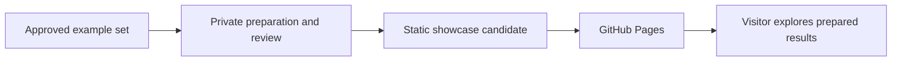

# Installation, Examples And Academic Release Plan

Prepared 26 September 2026, following the workshop/export reconciliation and the
researcher's Zenodo capture. This plan now includes the implemented public/conference profiles and the
completed automated installation checks. See [demo acceptance](../docs/DEMO_ACCEPTANCE_2026-09-26.md)
for exact evidence and remaining human/hosted checks.

**Repository created:** [Synthetic-Realities/sda-vision](https://github.com/Synthetic-Realities/sda-vision)
is **private**, with default branch `main` and an initial README only. GitHub CLI
authentication as **the authorised organisation administrator**, active organisation administrator membership and
repository read/write/admin permissions were verified. The separate GitHub
connector returned 404 for this private repository; CLI access supports the current
work, while plugin/cloud repository access needs its own configuration if required.
The existing repair history and application/media files have not been pushed.

**Public demo scope confirmed by the researcher:** the GitHub Pages version is an
interactive demonstration using the selected examples, with **no new visitor
uploads**, consistent with the researcher's stated DPIA and Ethics clearances.
The researcher has now explicitly selected **saved results** for this website,
including Developer batches of bundled examples. Report and approved original
downloads remain available for Second Opinion and Google Lens. A separate
**Conference demo with fresh analyses** is required for the upcoming Innovation
cafe. This is a separate delivery profile; the website remains a recorded demo.

## Decisions And Evidence So Far

| Area | Current position | Next result needed |
| --- | --- | --- |
| Academic home | **Synthetic-Realities/sda-vision** created and verified private; initial README on `main`. | Import the reviewed clean source export; complete setup/testing before a separately approved public visibility change. |
| GitHub connection | CLI authenticated as **the authorised organisation administrator**, active organisation admin with read/write/admin repository access. The separate connector cannot yet retrieve this private repository. | Use verified CLI access; configure selected repository access separately if plugin/cloud workflows are needed. |
| Podcast | Researcher's two-page capture shows an unpublished preview at record **21302105** and reserved all-versions DOI **10.5281/zenodo.21302104**. The displayed audio MD5 matches the local original. | Complete metadata, report matching and rights before publishing the existing draft. |
| Example replacement | The [replacement guide](../docs/Example_Pack_Replacement.md) already calls for new OpenAI and Google originals, clear source labels and separate checker evidence. | Acquire and document the selected originals, then test the Second Opinion workflow. |
| Installation | Fresh isolated macOS installation passed; 224 tests passed inside the extraction. | Physical-device and independent-platform checks remain. |
| Physical devices | iPad/Safari, Android/Chrome and actual presentation-software checks remain unrecorded. | Record results on available physical devices and state the resulting support scope. |
| Website | Separate public/workshop builds and static browser checks passed. | Review final media/rights, physical devices and exact publishing bundle. |
| Demo controls | Delivery labels, clearer layout toggle, bundled-example batches and browser-only notes/downloads implemented and tested. | Researcher review and final-example checks. |
| Conference demo | Dedicated authenticated, fixed-example profile implemented; mocked browser/backend checks pass. | Mac/projector and live rehearsal; decide local/Render backend and exact inputs/accounts/costs. |
| Render | **Connection verified:** management tools are available and the workspace query returns **Synthetic Realities**. A service query including previews returned `null`, with no service entries. | Project grouping, region and billing remain unverified. A hosted conference backend is an option; Pages needs no analysis backend. |

## Work That Can Proceed Before Final Example Approval

Example approval is a dependency for the final media-containing release, not a
blanket stop on development. Keep provisional media local and use test fixtures
and mocked provider replies for routine checks.

| Work | Can proceed now | What final examples change |
| --- | --- | --- |
| Public demo implementation | Mode labels, bundled-example queue, browser-only notes/session exports and upload/network guards | Final picker contents, recorded findings and exact downloadable files |
| Conference preparation | Dedicated profile, mocked live flows, Render configuration preparation and fallback design | Actual rehearsal inputs, report context and event running order; paid calls remain separately scoped |
| Installation and general acceptance | Clean source extraction, dependency installation, mocked tests, browser/export checks | Repeat affected preview, size/performance, format and download checks with the chosen originals |
| Private source preparation | Inspect a clean source import and exclude unapproved media | Final source/example packaging allowlists and credits |
| Metadata and conference drafting | Software/podcast metadata checks, structure, instructions and placeholder layouts | Final media credits, example-specific screenshots, findings and answer keys |
| Public media release | Prepare manifests, hashes and review records locally | Researcher's selection and redistribution details are required before inclusion in public bundles/downloads |

For example review, the researcher identifies the chosen originals, which may be
publicly downloaded or only demonstrated, and their known creation/source and
reuse details. Codex can prepare hashes, filenames, credits and a concrete review
inventory. A positive detector result is not a prerequisite for including an
example: record the actual check result and uncertainty. Selecting an example
does not by itself authorise a new paid analysis or an external media transfer.

## 1. Agree The Release Shape And GitHub Access

Agreed release route: **the private source repository, a GitHub Pages project site
with a recorded interactive showcase, local-install instructions, and a separate
live conference demonstration**. The source
repository becomes public after setup/testing and approval. The exact software
version and selected examples remain release decisions.

The existing personal login can administer a separate academic organisation. A
second personal login is unnecessary for this arrangement. The same GitHub App can
be installed on a personal account and organisations, with repository access chosen
for each installation. [GitHub installation guidance](https://docs.github.com/en/apps/using-github-apps/installing-a-github-app-from-a-third-party)

Connection and source-import steps:

1. Completed: authenticate **the authorised organisation administrator**, confirm organisation admin membership,
   create the private repository and verify its visibility, permissions and README.
2. Prepare and inspect the clean source export locally, then import it into the
   new repository with repository-local authorship. Keep the repair history local.
3. If the GitHub connector is required, configure its installation for
   **Synthetic-Realities** and this selected repository, then verify access through
   that connector. Its current 404 does not negate the verified CLI access.
4. Confirm the exact destination and author identity before each remote operation.
   GitHub CLI now uses the authorised organisation administrator; other saved accounts remain separate.
5. If Codex cloud is used later, select the repository in its connection and
   create its environment. [Codex cloud setup](https://learn.chatgpt.com/docs/cloud)

Repository creation and CLI authentication were performed at the researcher's
request. No existing repository remote or commercial integration was changed;
the IntoTheDigital organisation invitation was left unchanged.
Creation of the private repository does not authorise a later visibility change.
On GitHub Free, plan the Pages launch for when the appropriate site repository is
public; do not make the source repository public merely to preview the site.
[GitHub Pages availability](https://docs.github.com/en/pages/getting-started-with-github-pages/what-is-github-pages)

## 2. Host The Agreed Demo; Prepare Its Results Separately

**GitHub Pages is sufficient for the current recorded interactive demo.** The
researcher has confirmed a fixed-example demonstration with no new visitor uploads.
This replaces the earlier proposal to trial a public live-analysis service.
GitHub Pages serves the built HTML, CSS, JavaScript and prepared assets.
[GitHub Pages scope](https://docs.github.com/en/pages/getting-started-with-github-pages/what-is-github-pages)

| Stage | Processing | Where it happens |
| --- | --- | --- |
| Prepare approved examples | Media extraction, any authorised provider analyses, report/export generation and graph preparation | Researcher's local preparation environment initially; optional private remote compute later. |
| Publish the accepted candidate | Copy the reviewed static site, saved results and approved downloads | GitHub Pages after publication approval. |
| Explore the demo | Select fixed examples, reveal saved findings, explore graphs and use available browser-generated workshop summaries | Visitor's browser; no live analysis API is required by the recorded-demo design. |
| Conference live demonstration | Presenter initiates fresh analysis of prepared examples; label new findings and retain a saved-results fallback | Full backend on the presenter's laptop, or a separately configured hosted backend such as Render. Dedicated profile implemented; event hosting choice remains open. |
| Full research app | New inputs and live analyses remain available in the separately installed application | Local installation, outside the Pages demo. |

Once published, the recorded Pages site works with the researcher's laptop switched
off. The models were called during preparation; there are no fresh LLM calls when
a visitor opens a saved result. For a live conference demonstration, Render could
host the Python backend, media preparation and API calls. The laptop would then be
a browser/presentation device. Publishing a frontend on Pages does not relocate
the existing local backend automatically. A local conference backend remains a
valid option, but it needs the laptop running and connectivity for provider calls.

### What the current implementation establishes

- `scripts/bake_showcase.py` runs preparation separately. New analyses need explicit
  provider-call authorisation; export-only refresh uses saved reports.
- `scripts/build_showcase.py` sets `VITE_SHOWCASE=1` and packages the selected cache
  and curated originals into a separate static output.
- `frontend/src/App.tsx` passes `allowUpload={!EXAMPLES_ONLY}` to the input panel and
  disables live deep-pass/frame/annotation controls in showcase mode.
- `frontend/src/api.ts` routes showcase analysis to `showcaseReport`, which loads
  a saved report for an example in the manifest. `frontend/src/showcase.ts` loads
  the prepared graphs and report downloads from static paths.
- Graph interaction and workshop PDF/PPTX/CSV generation still use the visitor's
  browser. Measure their performance on the physical devices; a static site is
  interactive even though it does not run Python for each visitor.

### Public Demo Implementation: 26 September

- [x] Persistent Research / Public saved-results / Conference live labels; local
  Research/Compact switch explicitly labelled as a layout control.
- [x] All three views select only bundled examples in the public build. Developer
  batches queue up to ten and open up to five selected saved reports.
- [x] Browser-generated session JSON/Markdown/CSV/PDF/PPTX exports; original
  recorded reports remain separate. Full cached graph scope is labelled.
- [x] Separate Gemini/OpenAI visitor notes and fresh-chat statements; original
  report JSON, score and model/date records unchanged. No note scoring or API call.
- [x] All views, five-item batches, dropped-file rejection, note reset/persistence
  and mobile layouts tested at a project subpath, with only static GET traffic.
- [x] Public and workshop variants checked separately; manual Google source-search
  links remain distinct from the hidden Second Opinion panel in the latter.
- [ ] Physical devices and the selected replacement examples remain to be checked.
- [ ] Final original/report/download rights and processing-record references still
  require review before public publication.

The [acceptance record](../docs/DEMO_ACCEPTANCE_2026-09-26.md) contains the evidence
and exact limits. Current tests used existing local examples and mocked provider
responses; they do not approve public redistribution of those examples.

### Conference Live Profile And Render

Confirmed dates: BMJ recording **27 September**, abstract **23 October**, and
Problem Clinic **29 October** (70 minutes, repeated groups up to ten). Dr Sam Martin
is also invited to the shorter Innovation café. The recording is landscape,
**2–2.5 minutes, maximum 2:30**. See the [BMJ script](../docs/BMJ_VIDEO_SCRIPT_2026-09-27.md)
and [offline examples worksheet](../docs/EXAMPLES_OFFLINE_HANDOVER_2026-09-26.md).

Following the researcher's installation in this chat, **Render connection is
verified**: the management tools are now callable and the workspace query returns
**Synthetic Realities**. An explicit query of that workspace's services, including
previews, returned `null`, with no service entries. This establishes working
authenticated access; it does not verify a separately named project grouping,
region or billing state. No Render service was provisioned. The earlier catalogue
and missing-tool blocker is superseded by this successful connection check.

The new conference requirement gives Render a possible **live processing** role,
in addition to optional preparation work. It is unnecessary for the public saved
demo. Plan a presenter-operated conference profile using the prepared example set;
arbitrary audience file uploads are outside the current agreed demo scope.

- [x] Give the conference profile a persistent “Conference — live analysis” label,
  distinct from “Public demo — saved results”. Keep model/date and processing
  status accurate in each view, batch and downloaded report.
- [ ] Choose local or hosted backend for the event. For Render, test a Linux
  container and native media dependencies, configure credentials on the server,
  and define presenter access, concurrency, timeouts and rate/cost limits.
- [x] The fixed-example route accepts approved example identifiers and
  resolve them on the server. Reject arbitrary file bodies, remote URLs and local
  paths; omitting the upload button alone does not enforce this boundary. Reuse
  the existing analysis method and preserve optional-send consent controls.
- [ ] Name the exact live examples, provider accounts, recipients, permitted
  context and budget before the rehearsal. Record actual storage/cleanup and
  distinguish saved reports from newly produced results. Do not send audience
  workshop responses to the models as a side effect of presentation mode.
- [ ] Rehearse a single example, a small batch, provider failure/timeout and the
  transition to saved results on the event laptop/projector. Test an offline
  fallback from locally saved assets if venue connectivity is a concern.
- [ ] Record the event date and freeze the conference profile, example hashes,
  provider settings and fallback before completing screenshots and delivery packs.

The dedicated profile is implemented and tested with mocks; the actual extracted
app also passes authentication/allowlist/zero-run checks with no provider keys.
A Docker context and schema-valid Render Blueprint are prepared. Linux container
execution, live provider rehearsal and physical presentation checks remain open.
No new paid inference, media transfer or deployment was performed. See the
[Conference runbook](../docs/CONFERENCE_RUNBOOK_2026-09-26.md).
[Render Docker support](https://render.com/docs/docker),
[Render connection guidance](https://render.com/docs/mcp-server)

Vercel could also host static assets or a separately designed processing service,
but neither Vercel nor Render is required to serve this cached Pages demo. The
previous comparison based on public upload sizes is no longer a deciding factor
for this release. Evaluate the conference backend against its actual native
dependencies, run times, access and cost requirements.

## 3. Finish The Podcast Draft

The supplied capture is named
`screencapture-zenodo-org-records-21302105-2026-09-26-09_07_47.pdf`.
Its Preview banner and Versions panel explicitly say this record is unpublished,
despite the date displayed beside the title. The sidebar describes
**10.5281/zenodo.21302104** as the all-versions DOI. Record URL **21302105** is a
different identifier; confirm the version DOI in the draft's metadata before using
it in citations. The public record API returned 404 on 26 September, consistent
with the preview status. Preserve the existing reservation.

The capture lists the original M4A and
`sda-vision-From_Mask_to_Vaccine_Mandates_podcast_m4a-1.pdf`.
The audio's displayed MD5 matches the local file:
`7156346e11d18e6b671641c5b5a90986`. This is a checksum match to the captured listing;
the remote media was not downloaded. See the [deposit review](PODCAST_DEPOSIT_REVIEW_2026-09-26.md)
for the local SHA-256, scope assessment and proposed description.

- [ ] Confirm creator spelling, ORCID, affiliations, funding acknowledgement,
  actual creation date and intended publication date in the existing draft.
- [ ] Replace duration/date/fellowship/repository placeholders. Use approximately
  **24 min 29 s** for the checked local audio.
- [ ] Confirm the intended audio resource type and licence. The preview displays
  **CC BY 4.0**; source-paper rights, generator terms and authority to redistribute
  the audio/report still need their own evidence.
- [ ] Save the actual attached report for local review, with its hash and date.
  The capture shows the pasted Gemini note, which was absent from the separately
  inspected cached JSON. Keep these records distinct.
- [ ] Recover the original Gemini reply/check context where available. Attribute
  the historical claim to that reply; distinguish pasted text from a structured
  watermark verification result. Confirm supported audio scope before making a
  current capability claim.
- [ ] Review the title and description's “ground-truth”, “known-watermarked”,
  “independently verified” and “rights-clean” wording against the evidence.
  Creation history, licence authority and checker findings are separate fields.
- [ ] If including the historical report, add an accompanying scope note without
  modifying the report. It interprets a machine transcript; its ratings are not
  calibrated probabilities. AI-origin detection from the sound itself is outside
  this workflow.
- [ ] Inspect the exact final files and metadata before publication approval;
  check the public record and resolving identifiers afterwards. Add software
  links when they exist, keeping paper, media and software DOIs distinct.

## 4. Refresh The OpenAI And Google Examples

Start with one matched pair of face-free health illustrations, one generated with
OpenAI and one with the intended Google/Gemini image product. Add a second matched
pair of journal-style figures if it improves the session. Record the actual
product/model selected; “Gemini-created” alone may not identify the generator.
Keep a rights-reviewed photographic control and, if useful, a labelled legacy
AI-generated example. Do not promise a positive credential or watermark result.

For each new original:

1. Preserve the exact downloaded bytes. Record generator/product, available model
   identifier, creation date, public-safe prompt reference, source rights, licence,
   filename and SHA-256 in the [asset register](ASSET_REGISTER.csv).
2. Label its **creation history** in the filename, credits and facilitator key;
   use the actual creation date. Keep labels outside the pixels. Record checker
   date, method, supported scope and outcome separately from the source label.
3. For a teaching demonstration, clearly named `OpenAI_…` and `Google_AI_…` files
   help participants select an original for Second Opinion. For a blinded exercise
   or evaluation, use neutral filenames plus a separate answer key: the present
   model prompt includes filenames, so source-labelled files reveal the answer.
4. Check current official vendor coverage, then run only the specifically approved
   external checks. Save the exact reply and fresh-session attestation. Keep
   absent, failed, unchecked, unavailable and inconclusive results distinct.
5. Exercise original download, prompt copying, the external checker link, manual
   attachment, returning to the app, reply attribution and export. Confirm that
   pasted observations stay outside the combined visual score. Test the controls
   actually available in each live/static presentation mode.
6. Create PDF/PPTX derivatives only after original selection. Record source hashes
   and page/slide mapping; check the derivative and extracted image separately.
7. Update credits and the source allowlist for approved files. Select the showcase
   set separately; new media needs new reports. Preserve previous originals,
   reports and frozen demos while replacements are reviewed.

Deliverable: a small labelled teaching pack, a facilitator answer/evidence key and
an exact-file rights/checking register. Generation and paid inference are separate
work steps requiring the agreed product/account and budget.

## 5. Rehearse A Fresh Installation

Use an **unapproved review export** to test installation before freezing the final
candidate. Repeat affected checks if fixes change the exported files.

| Check | Procedure and acceptance evidence | Initial state |
| --- | --- | --- |
| FI-01: exact input | Generate the allowlisted review ZIP; inspect contents and record its checksum/manifest. Extract to a new isolated directory with no development symlinks, `.env`, virtualenv, node_modules or copied private reports. | Not checked |
| FI-02: prerequisites | Start with native Apple Silicon macOS and an institution-approved Python 3.12 independent of Codex. Record OS, architecture, Python, Node and npm versions; the setup script requires Node 20.19+ or 22.12+ (and permits later major versions). Record ffmpeg/ffprobe and any document-rendering prerequisites. | Not checked |
| FI-03: setup | Follow the supplied instructions as a new user, run `setup.sh`, retain a redacted log, confirm hash-locked dependency installation, `pip check`, `npm ci` and frontend build. Record network dependency downloads. Add test dependencies only to the isolated test installation. | Not checked |
| FI-04: first start | Start with the candidate's sample settings and no provider keys; use mocks/fixtures for analyses. Confirm loopback startup, helpful missing-key/tool states and launch without an implicit reinstall. Do not copy the working project's secrets. | Not checked |
| FI-05: regression | Run the full current Python suite and relevant frontend/browser checks against this installation. Use mocked provider calls. Record counts, warnings, exact commands and candidate identity. | Not checked |
| FI-06: representative paths | Test approved image, PDF, PPTX, audio and video fixtures; empty/partial/successful, failed, unavailable and inconclusive records; provenance integrity/trust separation; consent reset; scoring isolation. | Not checked |
| FI-07: exports and data | Check MD/CSV/PDF/PPTX and standalone graphs; long notes, Unicode, model counts, sampled scope, score caveats and graph distribution-history wording. Check workshop response inclusion/exclusion, End session and New session behaviour. | Not checked |
| FI-08: dependencies | Recheck the final lockfiles for advisories and complete third-party notices, font/artwork terms and native-component records. Log unresolved findings and release decisions. | Not checked |
| FI-09: handover | Stop/restart and reopen exported files outside the app. Record support scope and remaining issues. A clean directory on this Mac does not establish a clean-machine or other-OS pass. | Not checked |

The current installer explicitly rejects Intel macOS for this lock. Treat Intel
macOS, Windows and Linux as separate portability work until tested; do not advertise
them as supported by inference from an Apple Silicon pass.

## 6. Check Physical Devices And Presentation Software

Use the same candidate version and approved sample set. Confirm the available
hardware before assigning dates. Tablets/phones act as browsers; they do not run
the desktop Python installer. For Pages, test the static staging site on devices.
A phone's localhost is its own device: testing the live backend across a local
network needs a separately agreed access setup and is not accomplished by opening
the laptop's loopback URL.

| Device/application | Checks | Initial state |
| --- | --- | --- |
| Conference laptop, actual browser and projector | Developer/Community views and the facilitator PDF, legibility, keyboard navigation, zoom, original downloads, long reports and recorded fallback. | Not checked |
| Physical iPad with Safari | Portrait/landscape, touch targets, scrolling, tabs, downloads/save/share, PDF/PPTX/CSV, copy prompt and return from the external checker. | Not checked |
| Physical Android device with Chrome | Same workflow, including file-picker/download behaviour and narrow-screen layouts. | Not checked |
| Actual PowerPoint; Keynote if used | Open and present research/workshop exports; edit text; check pagination/slides, long evidence, images, fonts and unsupported-character handling. | Not checked |
| PDF viewer and CSV application used at the event | Inspect readable text, image captions, links, table continuation, Unicode and complete response/evidence fields. | Not checked |
| Recorded fallback under event conditions | Load the agreed cached examples and resources; state which functions require connectivity. | Not checked |

For each row record **device/model, OS, browser/app version, build/archive hash,
date, tester, steps, result and evidence path**. Use Pass / Issue / Not checked /
Unavailable with a reason. An emulated browser viewport is useful preliminary
evidence; it does not complete the physical-device row. Put completed outcomes in
the [test record](TEST_RECORD.csv) and link any reproducible issue.

## 7. Complete Metadata, Accept Candidates, Then Build Conference Packs

1. **Metadata and rights:** complete [release identity](RELEASE_METADATA.md), author
   order/ORCIDs, funding, existing institutional-approval references and processing
   scope, code/media licences and public support contact. Use the verified
   Synthetic-Realities/sda-vision URL and retain its private-preparation status until release. Resolve `TODO_RELEASE` values in
   active public metadata; validate CFF and any active Zenodo JSON together.
2. **Acceptance:** close release-blocking findings from installation, devices,
   exports, dependency/asset review and consent/processing checks. Scope any live
   provider test by named input, recipient/account and budget before running it.
   Record untested or unavailable features and decide whether to exclude them.
3. **Software candidate:** agree version/tag, generate the final clean source ZIP,
   inspect its manifest and checksum, and import the approved export into the new
   private repository, keeping its initial README history. Keep private repair history local.
4. **Showcase candidate:** build to separate staging directories using the
   [showcase guide](../docs/Showcase_Deploy_Guide.md). Review the exact cached
   reports, original-media downloads and rights. Test at the intended Pages
   subpath, all presentation modes, summary exports, fonts and external links.
5. **Version freeze:** record both candidate hashes, method/copy versions,
   selected examples and acceptance results. Choose GitHub-release archiving or
   manual Zenodo software deposit, avoiding duplicate archiving routes.
6. **Conference packs:** complete Packs 2–5 and the delivery materials against
   that freeze and the separately accepted live conference profile. Label each
   instruction and screenshot as saved or live. Update Pack 1, activity instructions,
   example keys, QR/link targets and recorded fallback. Rehearse on the event equipment.
7. **Publication:** review the concrete repository/tag, Pages bundle and Zenodo
   record files/metadata, then obtain approval for those exact destinations and
   contents. Verify the public links, downloads and identifiers afterwards.

A change after the freeze gets a new candidate identity and focused rechecking of
the affected flows. The [final release checklist](RELEASE_CHECKLIST.md) remains
the publication record.

## Initial Planning Verification, Before Repository Creation

The capture was visually inspected on both pages; the local audio MD5 was compared
with its file listing; the public organisation and record API were checked; current
GitHub, Codex, Zenodo and Vercel guidance was consulted. The release documents now
distinguish the recovered preview from the separate cached report and record the
chosen academic owner. No fresh installation, physical-device check, generator
call, provider inference, media upload or publication was performed by this plan.

Planning verification: **4 candidate-packaging tests passed**. The new plan is
explicitly included in the source allowlist; local document links were checked.
These checks establish documentation/package consistency, not release acceptance.

## Subsequent Repository And Demo-Scope Verification

GitHub CLI authentication completed as the authorised organisation administrator. Read-only membership checks
confirmed active admin status; the repository-creation command succeeded; follow-up
API checks confirmed private visibility, `main`, read/write/admin permissions and
README-only contents. The separate GitHub connector returned 404 for the new
private repository. Render plugin installation was confirmed from the catalogue;
its service state could not be inspected through the available tools.

The showcase preparation and frontend/API routing were inspected to reconcile the
researcher's fixed-example, no-upload scope. Documentation and local links were
updated; no app logic, prompts, scores, settings or stored reports were changed.
No static candidate was rebuilt, no new provider call was made and no media or
application source was uploaded. The source inspection does not replace the planned
static build, network and physical-device acceptance checks.

## Subsequent Saved/Public And Live/Conference Decision

The researcher explicitly chose saved results for the live public website and
requested a separate conference mode for fresh Innovation cafe analyses. Source
inspection established the toggle and batch gaps above. The latest Render
catalogue state differed from the previous check; a connection suggestion was
issued, but access has not been established. This update changes the plan and
release cross-references only. No app behaviour, settings, report or frozen demo
was changed, and no new browser/network acceptance result is claimed.

The researcher also clarified the need to paste external Gemini/OpenAI replies
back into the website. The plan retains this as browser-session interaction with
downloadable notes, independent of the laptop and without fresh in-app inference.
The current static implementation disables paste handlers and uses pre-generated
report files; both need adaptation before this workflow can be accepted.

Document verification for this continuation: seven updated Markdown files and
45 local links checked successfully; no trailing whitespace or unmatched fenced
blocks found. These are documentation checks, not application acceptance tests.

Subsequent Render connection check: after installation within this chat, a live
workspace query succeeded and returned **Synthetic Realities**. The workspace's
service query returned `null` without an error. Management access is now available;
project grouping and billing were not inspected and no deployment was performed.
