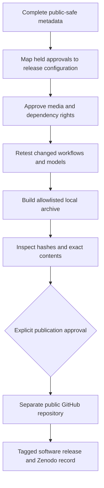
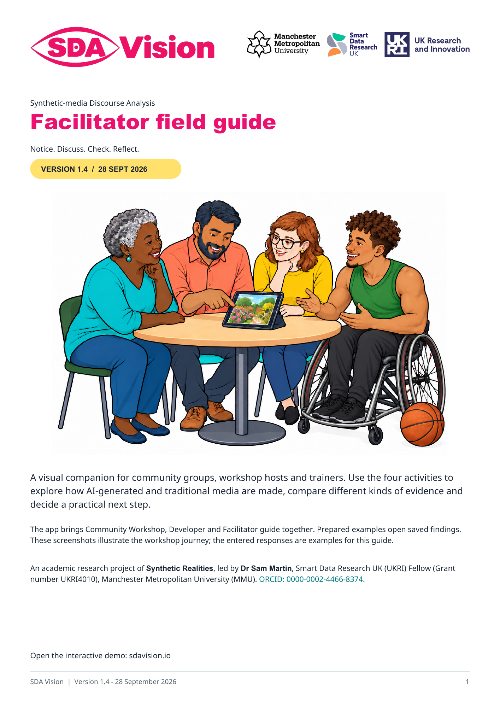

> **28 September 2026:** Software 0.1.0 and facilitator guide 1.4 are published as separate Zenodo records. See the [publication record](PUBLICATION_2026-09-28.md). See [today’s acceptance record](ACCEPTANCE_2026-09-28.md) and [current metadata](RELEASE_METADATA.md). Earlier dated plans below record preparation history.

> Current position, 27 September: the public demo contains ten prepared examples

SDA stands for **Synthetic-media Discourse Analysis**. The app and guide support research and discussion about **AI-generated and traditional media**.
> with saved model assessments. The full application source remains private. See
> [the copy review](../docs/Editorial_Review_2026-09-27.md) and
> [the Community demo update](COMMUNITY_DEMO_UPDATE_2026-09-26.md).

> Current update: the researcher confirmed MIT and requested the tested Pages
> launch. See [Pages acceptance](PAGES_ACCEPTANCE_2026-09-26.md) for the initial
> public preview. The remaining version/tag/DOI and conference rehearsal items
> below concern the later versioned software/Zenodo release, unless explicitly
> identified as unresolved in that acceptance record. Earlier private-checkpoint
> and dependency decisions are retained as preparation history.

# Release Pack: Start Here

Prepared 24 September; reconciled 26 September 2026 with the workshop/export changes of 25 September. This preparation pack brings together the records for a later software release;
fields awaiting completion are marked explicitly. The researcher confirms that university and funder
approvals are held. This pack records their references and maps the release to
their approved scope. Institutional decisions and approval evidence remain with
the researcher and institution.

Complete fields marked `TODO_RELEASE` with permitted public references or
redacted statements. Keep signed letters, private DPIAs, signatures, participant
data and API credentials in their authorised private stores.

## Work In Short Sessions

Start with [next steps and what Sam needs to provide](NEXT_STEPS_GITHUB_PAGES_ZENODO_2026-09-26.md)
and the [installation and release plan](INSTALLATION_AND_RELEASE_PLAN_2026-09-26.md),
which records Synthetic-Realities, the recovered podcast preview, example replacement,
hosting choices and fresh-install/device checks. Use the
[current readiness assessment](READINESS_2026-09-26.md), then the
[GitHub/Pages/account options](PUBLISHING_ROUTE_2026-09-26.md) and
[podcast deposit review](PODCAST_DEPOSIT_REVIEW_2026-09-26.md). The software archive,
static Pages showcase and podcast are separate outputs with separate review needs.
The earlier CSV test rows remain historical records; current checks and remaining
acceptance work are reconciled in [VALIDATION.md](VALIDATION.md).

| Session | Open | Finish when |
|---|---|---|
| 1: identity | [Release metadata](RELEASE_METADATA.md) | Authors, affiliation, licence decision, version and funding are confirmed |
| 2: approvals | [Processing record](PROCESSING_RECORD.md) | Approval references and implementation match are recorded |
| 3: examples | [Asset register](ASSET_REGISTER.csv) and [replacement guide](../docs/Example_Pack_Replacement.md) | Each selected example has provenance and redistribution evidence |
| 4: checks | [Test record](TEST_RECORD.csv) | Reported passes have evidence; repaired workflows have been retested |
| 5: release | [Final checklist](RELEASE_CHECKLIST.md) | Exact archive, metadata and destination have explicit approval |

## Included Templates

- `CITATION.cff.template`: proposed citation fields, not active machine metadata.
- `zenodo.json.template`: optional GitHub-Zenodo metadata, not an active upload.
- `RELEASE_NOTES.md`: change summary and known limitations for the release page.
- `ASSET_REGISTER.csv`: one row per original/derivative; append new records to preserve history.
- `TEST_RECORD.csv`: focused acceptance tests, including the screenshot observation.
- `PLATFORM_TEST_RECORD.csv`: separate original/derivative and external-verification records; template rows are not passes.

The root `CITATION.cff` records the agreed author, affiliation, ORCID and funding.
Review version-specific fields against the final candidate and validate them
before the software release. If you activate `.zenodo.json` too, keep both in
agreement: Zenodo gives JSON precedence over CFF for GitHub release archiving.
[Zenodo metadata guidance](https://help.zenodo.org/docs/github/describe-software/zenodo-json/).

## Technical References

- [Privacy/data flows](../PRIVACY.md)
- [Method change record](../docs/Method_Change_Record_2026-09-19.md) (historical rules)
- [Current release notes](RELEASE_NOTES.md)
- [Technical validation](VALIDATION.md)
- [Model configuration](../docs/Provider_Upgrade_2026-09-24.md)
- [C2PA trust policy](../docs/C2PA_Trust_Policy.md)
- [C2PA 2.4 upgrade](../docs/C2PA_2_4_Upgrade_2026-09-24.md)
- [Platform scope and conference questions](../docs/Platform_Provenance_Scope_2026-09-24.md)
- [Third-party review](../docs/Third_Party_Release_Review.md)
- [Previous automated checkpoint](../docs/Release_Candidate_Readiness_2026-09-19.md)
- [Workshop activities](../docs/Workshop_Activities_2026-09-25.md)
- [Workshop language review](../docs/Community_Facilitator_Copy_Audit_2026-09-25.md)
- [Report layout and session downloads](../docs/Report_Layout_And_Session_Downloads_2026-09-25.md)

Run `.venv/bin/python scripts/package_candidate.py` from the app root to regenerate
the unapproved review ZIP. The 26 September allowlist includes the illustration
source/provenance note, export font/licence, workshop helper test and reconciliation
records. Media is opt-in through `--example-bundle`; without it the source archive
contains no example originals. The validated bundle supplies neutral copies and
replaces the development example inventory/credits. Use `--frontend-dir` for a
separately built research frontend. Update the allowlist for activated root
metadata. Use the allowlisted export as the publication input; the workspace
and private repair history stay in the local preparation environment. The
packaging command creates a local review archive for inspection.

## Illustrated facilitator guide - version 1.4

An academic research project of **Synthetic Realities**, led by **Dr Sam Martin**, Smart Data Research UK (UKRI) Fellow (Grant number UKRI4010.), Manchester Metropolitan University (MMU). [ORCID: 0000-0002-4466-8374](https://orcid.org/0000-0002-4466-8374).

[Download the approved guide](../docs/guides/SDA_Vision_Facilitator_Guide_v1.4.pdf). [Zenodo preparation pack](zenodo/README.md) contains its version, credits and exact-file manifest.

The [current interface review](../docs/Release_Pack_Audit_2026-09-27.md) records the integrated guide, media controls, batch selection and updated screenshots.

## PowerPoint preview setup

Uploaded slide previews use an optional local LibreOffice installation. The public demo includes prepared slides. See [installation and preview guidance](../docs/PowerPoint_Preview_Setup.md).

The installation app includes the collapsed Developer Batch queue and Harvard-style analysis citations with Dr Sam Martin, MMU and grant UKRI4010. See [batch and citation guidance](../docs/Batch_And_Citation_2026-09-28.md).
